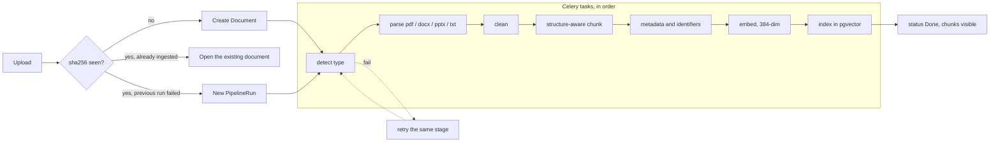

# Ingest pipeline

One Celery task per stage. The status page reads `PipelineRun` and `PipelineStage`. A stage that raises is marked `retrying` and the task is retried, up to `INGEST_MAX_RETRIES` extra attempts. The same file hash never creates a second `Document`.

What each stage writes:

| Stage | Reads | Writes |
| --- | --- | --- |
| detect | the file bytes | `Document.file_type` |
| parse | the file | `blocks.json`, `page_count` |
| clean | `blocks.json` | `cleaned.json` (running headers dropped) |
| chunk | `cleaned.json` | `chunks.json` (section path, page range, token count) |
| enrich | `chunks.json` | `enriched.json` (AD numbers, part numbers) |
| embed | `enriched.json` | `embeddings.npy` |
| index | both of the above | `Chunk` rows, including the vector |

Chunking breaks on headings and on the token budget (`INGEST_CHUNK_MAX_TOKENS`, default 300). The heading text stays inside the chunk, and the section path is stored on the row, so a later citation can say which section and page it came from.
